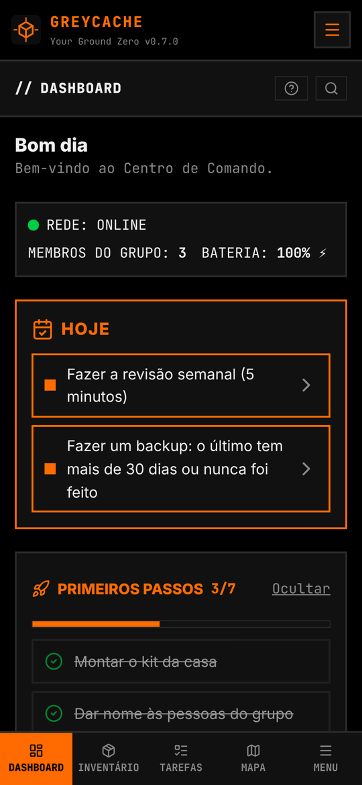
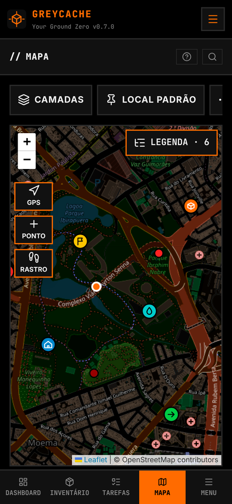
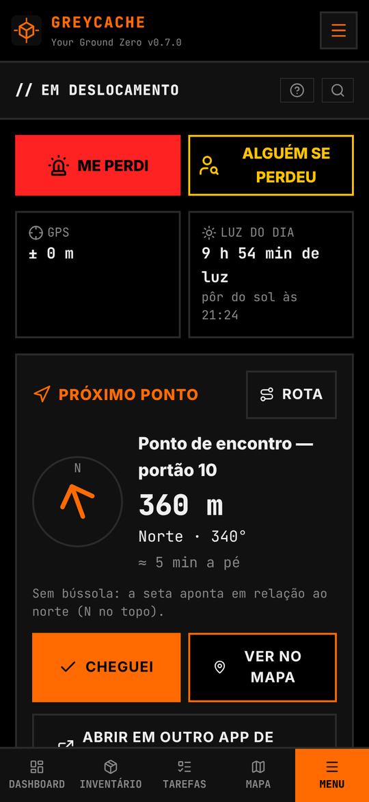
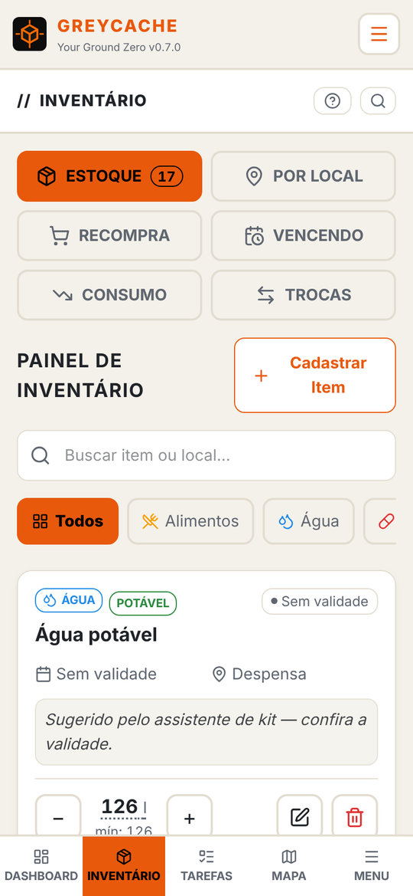
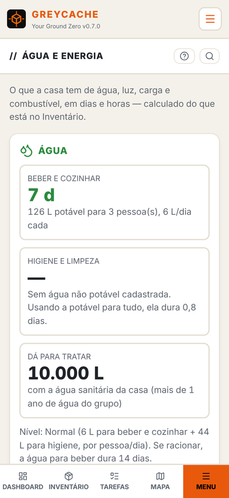
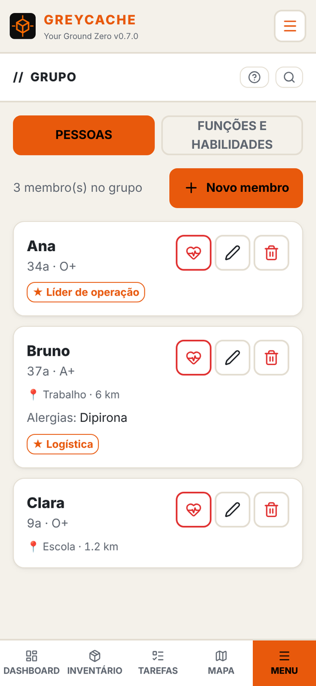
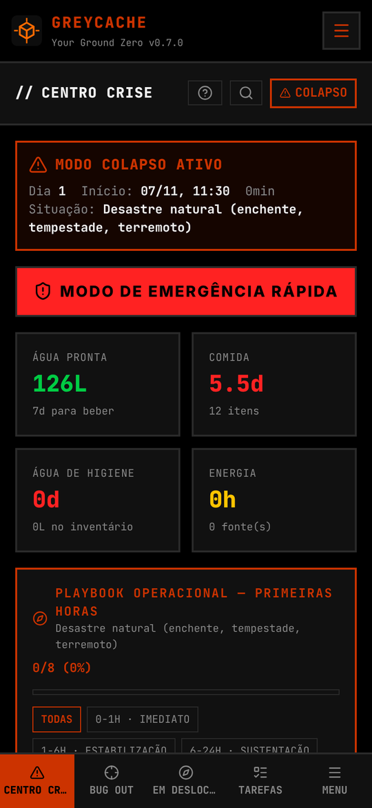

# GREYCACHE — *Your Ground Zero*

> *"Quando tudo falhar, você ainda tem o GREYCACHE."*

Central de operações **100% offline** para preppers, sobrevivencialistas e gestores de crise. Um PWA self-hosted que funciona sem nuvem, sem cadastro e sem telemetria: **todos os dados ficam no dispositivo de quem usa** (IndexedDB), com backup por export JSON. O container principal serve apenas os arquivos estáticos. Opcionalmente, um segundo container (`greycache-sync`) deixa os celulares do grupo sincronizarem **pela rede de casa, sem internet** — e mesmo ele só guarda pacotes cifrados que não consegue ler.

## Telas

<table>
  <tr>
    <td align="center" width="25%"><br><sub>Painel: o que importa hoje</sub></td>
    <td align="center" width="25%"><br><sub>Mapa offline com pontos e relatos</sub></td>
    <td align="center" width="25%"><br><sub>Em deslocamento: seta até o ponto de encontro</sub></td>
    <td align="center" width="25%"><br><sub>Inventário com validades e autonomia</sub></td>
  </tr>
  <tr>
    <td align="center" width="25%"><br><sub>Água e energia em dias</sub></td>
    <td align="center" width="25%"><br><sub>Grupo e funções</sub></td>
    <td align="center" width="25%"><br><sub>Centro de Crise no Modo Colapso</sub></td>
  </tr>
</table>

<sub>Imagens com dados fictícios.</sub>

## O que o app faz

- **Modo Preparação** (rotina): inventário com autonomia calculada (calorias estimadas automaticamente, validades por lote), estoque mínimo com Lista de Recompra, caixa de medicamentos com cobertura em dias da medicação de uso contínuo, frota com checklists, equipamentos e manutenção, arsenal com documentos vigiados, mapa com waypoints e áreas offline (com uma fonte de mapas que permita uso offline), biblioteca de conhecimento, Índice de Prontidão 0–100 e Revisão Semanal guiada.
- **Modo Colapso** (crise ativa): decisão de Bug Out por gatilhos, plano de reunificação, painel de água, calculadora de energia, mapa de situação, registro de perímetro e consumo real vs planejado.
- **Fácil de começar e de usar**: assistente monta o kit da casa pelo tamanho do grupo e pelos dias de autonomia (você informa o que já tem e o resto vira lista de compras); painel **Hoje** com as poucas tarefas que importam agora; texto em três tamanhos; telas com janelas e botões grandes; português, inglês e espanhol.
- **Pasta de emergência** em PDF para imprimir: contatos, cartões médicos, plano de comunicação, reunificação, locais do mapa, mochila de fuga, remédios e veículos.
- **Backup com senha** (AES-256, tudo no aparelho) e backup automático em pasta no APK.
- **Privacidade por arquitetura**: sem anúncios, sem conta, sem "ligar para casa" — para sempre.

## Instalação rápida

```bash
docker run -d --name greycache -p 8090:80 --restart unless-stopped ghcr.io/ianmaicon/greycache:latest
```

Abra `http://SEU_IP:8090`. No celular, use **"Adicionar à tela inicial"** para instalar como app.

## App Android (APK)

Baixe o `greycache-vX.Y.Z.apk` da versão mais recente em
**[Releases](https://github.com/ianmaicon/greycache/releases/latest)** e instale no aparelho
(permita "instalar apps desconhecidos" para o navegador/gerenciador de arquivos).
Notificações agendadas e backup automático em pasta só existem no APK.

Para receber as atualizações sem baixar o APK à mão, use o
**[Obtainium](https://github.com/ImranR98/Obtainium)**: Adicionar app →
`https://github.com/ianmaicon/greycache`.

## Docker Compose / Portainer

```yaml
services:
  greycache:
    image: ghcr.io/ianmaicon/greycache:latest
    container_name: greycache
    ports:
      - "8090:80"
    restart: unless-stopped
    # Sem volumes, de propósito: os dados vivem no dispositivo de cada
    # usuário (IndexedDB) — backup pelo próprio app (Ajustes → Exportar JSON)
    read_only: true
    tmpfs:
      - /var/cache/nginx
      - /run
    security_opt:
      - no-new-privileges:true
    healthcheck:
      test: ["CMD", "wget", "-q", "--spider", "http://127.0.0.1/"]
      interval: 60s
      timeout: 5s
      retries: 3
      start_period: 5s
```

No Portainer: **Stacks → Add stack → Web editor**, cole o YAML acima e faça o deploy.
O container roda com filesystem **somente leitura** (endurecimento) — o nginx escreve apenas em tmpfs.

## Sincronização na rede de casa (opcional)

Com o `greycache-sync` rodando ao lado, os celulares do grupo (APK ou navegador) trocam as mudanças sozinhos pela rede local — sem internet, sem nuvem e sem passar arquivo de mão em mão. Sem ele, tudo funciona como antes (sincronização por arquivo/QR).

```yaml
  # Acrescente ao mesmo stack, abaixo do serviço "greycache":
  greycache-sync:
    image: ghcr.io/ianmaicon/greycache-sync:latest
    container_name: greycache-sync
    volumes:
      - greycache-sync-data:/data
    restart: unless-stopped
    read_only: true
    security_opt:
      - no-new-privileges:true

volumes:
  greycache-sync-data:
```

O nome do serviço precisa ser `greycache-sync`: o nginx do GREYCACHE encaminha `/api/sync/` para ele, então o endereço que o app usa é o mesmo do GREYCACHE (ex.: `http://192.168.0.10:8090`). O [docker-compose.yml](docker-compose.yml) completo já traz os dois serviços.

**Código de instalação.** Na primeira vez que sobe, o `greycache-sync` mostra no log um código de 8 dígitos (Portainer/TrueNAS: aba de logs do container; ou `docker logs greycache-sync`):

```
greycache-sync: servidor sem grupo. Código de instalação: 4827-1590
```

Se preferir escolher o código, defina `SETUP_CODE` no serviço (ex.: `SETUP_CODE: "48271590"`). O código só vale até o grupo ser criado.

**No app** — na primeira tela ("Entrar no grupo pelo servidor de casa") ou em Ajustes → Backup e dados → Servidor da rede de casa:

1. **Quem coordena o grupo:** digita o endereço (ex.: `192.168.0.10:8090`), toca em **Conectar**, informa o código de instalação e o nome do grupo e toca em **Criar o grupo**. Esse celular vira o **Usuário 1**.
2. **Cada outra pessoa:** digita o mesmo endereço, toca em **Pedir para entrar** e vê um código de 4 dígitos.
3. **No celular do Usuário 1** aparece o pedido com o mesmo código. Conferiu que é igual? Escolha **quais pastas** a pessoa recebe (por padrão, nenhuma) e toque em **Aprovar**.
4. Daí em diante sincroniza sozinho ao abrir o app, ao voltar a ter rede e a cada 5 minutos com o app aberto. O QR de convite continua existindo como atalho.

**Pastas do grupo.** O que cada pessoa cadastra (inventário, remédios, checklists) fica só no celular dela. O Usuário 1 cria pastas do grupo — "Despensa da casa", "Mochilas" — e libera cada uma para cada membro: **Ver** ou **Ver e alterar**. Só o que está dentro de uma pasta liberada é compartilhado; dá para liberar ou tirar acesso a qualquer momento (Ajustes → Backup e dados → Pastas do grupo).

**Remover um membro.** Em Ajustes → Backup e dados, **Remover do grupo**: o token do aparelho deixa de valer na hora e ele não recebe mais nada. Quando o celular removido voltar a falar com o servidor, recebe um aviso autenticado pelo Usuário 1 e apaga os dados do grupo — o que é só da pessoa fica. Quem sai por vontade própria também tem os dados do grupo apagados. Não dá para apagar um celular que nunca mais se conecta, nem backups ou prints que a pessoa tenha feito.

**O app não depende do servidor.** Ele é uma comodidade: sem servidor (ou longe de casa), o app funciona igual, e as mudanças vão quando a rede voltar. A sincronização por arquivo/QR continua disponível.

**Trocar o Usuário 1** (celular perdido ou trocado):

- **Com backup do Usuário 1:** restaure o backup no celular novo e escolha **Assumir como Usuário 1**. Ele continua o mesmo grupo; os membros nem percebem.
- **Sem backup:** gere um novo código de instalação com `docker exec greycache-sync node sync-server.mjs reset` (aparece no terminal e no log). Quem for coordenar cria o grupo de novo com ele; os outros pedem para entrar outra vez — os dados de cada celular ficam e se juntam.

**Como fica a segurança:**

- Os pacotes saem **cifrados de ponta a ponta** (AES-256-GCM) com a chave do grupo, criada no celular do Usuário 1. A chave só viaja dentro do QR de convite; o servidor nunca a recebe. Quem copiar o volume ou o container não lê nada.
- Cada pacote fica preso ao seu remetente e destinatário: o servidor não consegue trocá-los de lugar.
- O servidor exige o token do grupo e bloqueia por um minuto quem erra demais.
- Ninguém entra sem o Usuário 1 aprovar. O código de 4 dígitos nos dois celulares garante que nenhuma chave foi trocada no caminho.
- Cada aparelho tem o próprio token e os pacotes são cifrados só para o par Usuário 1 ↔ aquele aparelho (troca de chaves X25519): um membro não lê o que foi para outro, nem mexendo no servidor.
- O QR do servidor leva só o endereço; quem o lê ainda precisa ser aprovado.
- O código de instalação só existe até o grupo ser criado, e quem erra demais é bloqueado por um minuto.
- **Não exponha a porta na internet.** O uso previsto é a rede de casa.

**Fora de casa (opcional): Tailscale.** Para sincronizar ou abrir o GREYCACHE longe da rede local, instale o [Tailscale](https://tailscale.com) no servidor e nos celulares e use o endereço do Tailscale do servidor (ex.: `http://servidor:8090`, ou com HTTPS via `tailscale serve`). Nada de abrir porta no roteador. Na rede de casa, o Tailscale não é necessário.

**Navegador × APK:** no navegador, o endereço `http://` da rede local sincroniza normalmente, mas não instala o PWA nem o deixa abrir offline (os navegadores exigem HTTPS para isso). Nos celulares, prefira o APK; para o PWA instalado, use HTTPS (reverse proxy ou `tailscale serve`).

## Notas de operação

- **Sem volumes no container principal**: ele não guarda nada — os dados vivem no navegador/dispositivo de cada usuário. Atualizar o container não afeta dados de ninguém. O volume do `greycache-sync` guarda só os pacotes cifrados em trânsito: pode ser apagado (o grupo é recriado ligando o servidor de novo no Usuário 1).
- **Atualização**: `docker compose pull && docker compose up -d` (ou re-pull da Stack no Portainer).
- **Tags**: `latest` acompanha a última versão; versões fixas em `ghcr.io/ianmaicon/greycache:0.1.0` etc.
- **HTTPS**: para instalar o PWA fora de `localhost`, os navegadores exigem HTTPS — use seu reverse proxy habitual (Traefik, NPM, Caddy) na frente da porta 80.
- **Faça backup**: Ajustes → Exportar Backup JSON. Dados 100% locais significam que o backup é responsabilidade sua — o app avisa quando ele envelhece.
- Multi-arch: **amd64** e **arm64** (roda em NAS, mini-PC e Raspberry Pi).

## Privacidade

O app não coleta nada — veja a [Política de Privacidade](PRIVACIDADE.md).

## Bugs e sugestões

Abra uma **[Issue](https://github.com/ianmaicon/greycache/issues)** neste repositório — este é o canal oficial de suporte da versão self-hosted.

## Apoie o projeto

O GREYCACHE é e sempre será **100% offline — sem anúncios, sem telemetria e sem conta**.
Se ele é útil na sua preparação, considere apoiar o desenvolvimento:
**[livepix.gg/mrmayc](https://livepix.gg/mrmayc)** (Pix). O apoio é voluntário e não
desbloqueia nada — o app inteiro já é seu.

---

*O código-fonte é desenvolvido em repositório privado; este repositório é a casa pública da distribuição self-hosted (imagem Docker, instruções e suporte).*
